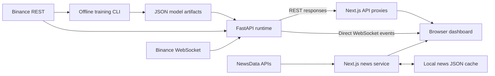

# Crypto Prediction Dashboard: project overview and portfolio improvement plan

This review describes the working tree inspected on 19 October 2026, including uncommitted changes. It is based on repository source code and local checks, rather than a deployed-product audit. Recommendations below are proposals; application behavior has not been changed as part of this review.

## 1. What this project is about

Crypto Prediction Dashboard is a full-stack cryptocurrency monitoring application that combines historical candlestick data, streaming market updates, experimental directional forecasts, and news. Its main user journey is to compare tracked assets, open a detailed symbol monitor, inspect price and volume, and compare recent forecasts with their eventual outcomes.

The strongest portfolio framing is:

> A real-time cryptocurrency analytics application built with Next.js and FastAPI, with a transparent NumPy forecasting baseline and an offline training pipeline.

The source demonstrates application engineering across several layers. It does not yet establish a reliable predictive advantage or profitable trading strategy. Model evaluation and live forecast semantics need work before making those claims.

This is an analytics application. There is no implemented user authentication, order execution, broker integration, or user portfolio accounting. News provides reading context; it is not an input to the current model.

Sources: [frontend composition](../components/dashboard/dashboard-client.tsx), [API entrypoint](../backend/app/main.py), [feature engineering](../backend/app/features.py), [training script](../backend/scripts/train_offline.py).

## 2. Current functionality

### Pages and navigation

| Route | Current behavior |
| --- | --- |
| `/` | Overview with a searchable multi-coin watchlist. |
| `/dashboard` | Redirects to the default symbol and chart range. |
| `/dashboard/[symbol]?range=...` | Detailed monitor with chart, selected-candle values, latest price, prediction, confidence, and paginated prediction history. Unsupported symbols redirect to the default symbol. |
| `/latest-news` | Market, Crypto, and Tech news sections with article pagination. |
| `/how-it-works` | Explains ingestion, training, streaming, prediction, and visualization. |
| `/features` | Redirects to `/how-it-works`. |

The configured frontend list contains BTC, ETH, BNB, SOL, XRP, ADA, DOGE, AVAX, LINK, and MATIC, all paired with USDT. This describes configuration, not verified current exchange availability. Backend symbols can be configured independently, but frontend route validation still uses its own static list.

### Chart ranges and forecast horizon

| User-facing range | Candle interval | Requested history |
| --- | --- | --- |
| Live | 1 minute | 60 candles |
| 1 Day | 5 minutes | 288 candles |
| 1 Week | 1 hour | 168 candles |
| 1 Month | 4 hours | 180 candles |
| 1 Year | 1 day | 365 candles |

These ranges change chart granularity and history. The public prediction endpoints always use the **15-minute forecast track**, regardless of interval or range query parameters. A one-year chart therefore still shows a 15-minute forecast.

The active candlestick renderer is custom SVG in `candlestick-chart-panel.tsx`. Although `lightweight-charts` is installed and mentioned in the README, the inspected application source does not import it. Describe the implemented renderer accurately or deliberately adopt the library later.

Sources: [pages](../app), [frontend constants](../lib/constants.ts), [prediction endpoints](../backend/app/main.py), [chart renderer](../components/dashboard/candlestick-chart-panel.tsx).

## 3. Technical architecture

### Stack

| Layer | Implementation |
| --- | --- |
| Web application | Next.js 16.2.4 App Router, React 19.2.4, TypeScript |
| Styling | Tailwind CSS v4 and global CSS |
| Charts | Custom SVG candlestick and volume renderer |
| Application API | Python 3.11+, FastAPI, Pydantic response models |
| Exchange integration | `httpx` REST client and `websockets` streaming client |
| Prediction model | NumPy logistic regression with L2 regularization |
| Model artifacts | JSON files loaded into memory at backend startup |
| Runtime storage | In-memory candle buffers, forecasts, and prediction history |
| Active news integration | Next.js server routes calling NewsData, with local JSON cache |
| Tests | Vitest, React Testing Library, Playwright |

### Data flow



Market REST requests go from the browser to Next.js API routes, which proxy to FastAPI. Live events connect directly from the browser to FastAPI using `NEXT_PUBLIC_WS_URL`. `/api/market/stream` is not a functioning stream proxy: it returns setup information or HTTP 501.

The browser does not call Binance directly. The active news path is separate: Next.js itself calls NewsData. FastAPI also contains an `/api/news` implementation, but the current Next.js `/api/news` route uses the Next.js news service instead of forwarding to Python. This duplication should be resolved or clearly documented.

### Backend lifecycle

1. Load available artifacts for configured symbol/interval pairs.
2. Bootstrap historical candles concurrently from Binance REST.
3. Maintain rolling buffers of up to 5,000 candles per pair.
4. Start a combined Binance WebSocket subscription.
5. Replace an existing forming candle or append a new candle on updates.
6. Compute or retrieve forecasts and update recent history.
7. Broadcast events to matching browser connections.

The upstream stream loop retries after exceptions with increasing delays capped at 20 seconds. The browser adapter currently creates a single socket and does not retry after it closes. Those are different reliability properties.

Sources: [proxy](../lib/server/proxy.ts), [stream adapter](../lib/stream/adapter.ts), [market hook](../hooks/use-market-dashboard.ts), [runtime](../backend/app/runtime.py), [exchange client](../backend/app/binance.py), [news service](../lib/server/crypto-news.ts).

## 4. How the machine learning works

### Inputs and features

Each model uses ten numeric features calculated from candlestick windows:

| Feature | Meaning |
| --- | --- |
| `ret_1`, `ret_3`, `ret_6` | Close-price returns over 1, 3, and 6 periods |
| `range_pct` | High-low range divided by close |
| `body_pct` | Close-open change divided by open |
| `upper_wick_pct`, `lower_wick_pct` | Upper and lower wick sizes relative to open |
| `vol_rel_20` | Current volume divided by average volume over 20 periods |
| `trend_12`, `trend_24` | Close-price changes over 12 and 24 periods |

The feature lookback is 24 periods. No news sentiment, order book data, on-chain data, or deep learning is implemented.

### Offline training

The CLI fetches historical candles separately for each requested symbol/interval. The configured default request is 1,200 candles, with a default minimum of 250 training examples. It constructs this label:

```text
UP:   next candle close > current candle close
DOWN: next candle close <= current candle close
```

The first 80% of examples train the model; the remaining 20% validate it. This preserves chronological order. Standardization statistics are fitted on the training partition and applied to validation, which is a sound existing choice.

Training uses gradient descent and L2 regularization. Artifacts contain weights, bias, feature names, mean, standard deviation, training timestamp, sample count, and validation accuracy, precision, and recall. A combined training report is also written. Models load at startup; there is no implemented scheduled retraining or artifact promotion workflow.

### Inference and confidence

For model probability `p`, the application selects UP when `p >= 0.5` and reports:

```text
confidence = max(p, 1 - p) * 100
```

This is a model score. It is not measured accuracy, and the code does not establish that a displayed 75% score corresponds to 75% correct forecasts.

If no artifact is available, the backend can still return the current candle's direction with a 50% score and an OFFLINE status. The visible prediction card does not currently expose that distinction clearly enough.

Sources: [features](../backend/app/features.py), [model math and artifact payload](../backend/app/modeling.py), [training split](../backend/scripts/train_offline.py), [artifact loading](../backend/app/model_store.py), [runtime inference](../backend/app/runtime.py).

## 5. What already makes this worth showing

- **End-to-end ownership:** historical ingestion, preprocessing, training, serialization, inference, APIs, streaming, and UI are all represented.
- **Understandable model implementation:** a compact NumPy baseline gives you concrete decisions and mathematics to explain in an interview.
- **Useful separation:** transport, feature generation, model math, artifact storage, runtime orchestration, and UI components are separate modules.
- **Real streaming behavior:** the runtime handles forming candles, closed candles, subscriptions, and bounded state.
- **User-oriented navigation:** shareable symbol/range URLs, watchlist search, candle inspection, and paginated forecast outcomes provide a coherent workflow.
- **Honest foundations:** offline model status, loading/error states, chronological validation, and training-only scaling are already present in the implementation.

These strengths support a full-stack engineering portfolio entry. For an ML engineering entry, the evaluation and forecast corrections below become essential evidence.

## 6. Highest-priority improvements

### P0: Make training and live forecasting describe the same task

**Finding:** training predicts the next candle's close relative to the current close. Live 15-minute forecasts use the latest, potentially forming candle, lock one forecast for that candle, and resolve its close against its open. The model's training target and displayed outcome differ. In addition, equality is DOWN during training and UP during live resolution.

At startup, the runtime can create a forecast partway through a candle but record its creation at the candle's opening timestamp and its anchor at the opening price. That can make the history imply an earlier prediction than the system actually issued.

**Recommended contract:** once candle `t` closes, use only candles through `t` to predict whether candle `t+1` closes above candle `t`'s close. Store the actual issue timestamp separately from target-window start/end timestamps. If startup occurs mid-window, either wait for the next eligible close or explicitly mark a delayed forecast with its remaining horizon. Apply one documented tie rule everywhere.

**Done when:** a deterministic replay proves that every forecast uses only information available at issue time, is immutable once issued, and resolves against exactly the training label. Late startup, duplicate events, missed candle closes, and restart recovery have explicit behavior. Exclude unfinished candles from training labels.

Evidence: [training labels](../backend/app/features.py), [forecast locking and resolution](../backend/app/runtime.py). See also the [technical model appendix](model-review-notes.md).

### P0: Make missing-model and stale-data states visible

Show model state, model version/training date, latest market-event time, connection state, forecast issue time, and target time beside the signal. Label heuristic fallbacks explicitly or suppress them as model predictions. A numerical confidence score should not imply that a model is loaded.

The hook returns `streamStatus`, but `DashboardClient` does not display it. An existing `StreamStatus` component can be integrated. Readiness should depend on required artifacts and fresh data; `/health` currently only returns `{"ok": true}`.

**Done when:** a reviewer can tell whether they are viewing a trained forecast, delayed snapshot, disconnected stream, unavailable model, or replay dataset without inspecting logs.

Evidence: [dashboard](../components/dashboard/dashboard-client.tsx), [status component](../components/dashboard/stream-status.tsx), [health endpoint](../backend/app/main.py).

### P0: Fix browser reconnection and catch-up

The adapter sets the label `reconnecting` on an error but never creates a replacement socket. Add bounded exponential backoff with jitter, cancellation on unmount, and snapshot refresh after reconnect. Reconcile buffered live events with the initial REST snapshot so a late snapshot cannot overwrite newer state.

Separately, reconnecting the upstream Binance socket does not backfill missing candles. Fetch and merge gaps before treating forecasts as current. Enforce sorted, unique candle timestamps and protect state against stale/out-of-order updates.

**Done when:** disconnect/reconnect tests demonstrate recovery, no duplicate forecasts, no stale state overwriting fresh state, and visible delayed status during catch-up.

Evidence: [adapter](../lib/stream/adapter.ts), [snapshot/live reconciliation](../hooks/use-market-dashboard.ts), [ingestion loop](../backend/app/runtime.py).

### P0: Correct watchlist market statistics

The watchlist derives its 24-hour change and volume from candles at the selected chart interval. In Live mode it requests 1,441 one-minute candles, but the default bootstrap holds only 365. During initial loading, the requested window can force additional upstream reads for each symbol.

The live adjustment adds `driftPct * 0.15` to the stored percentage change; that is not an exact rolling 24-hour calculation. Coarse chart ranges also cannot represent a precise rolling 24-hour window consistently. Volume is summed in base-asset units, making cross-coin comparisons ambiguous unless units are shown.

Use a dedicated backend market-summary response with independently defined 24-hour statistics, timestamps, and base/quote volume units. Keep these statistics independent of chart range. Preserve successful rows if one asset fails instead of clearing the whole watchlist.

**Done when:** 24-hour figures remain consistent when switching chart ranges, empty histories do not throw, and volume units are explicit.

Evidence: [watchlist hook](../hooks/use-watchlist-data.ts), [table](../components/dashboard/watchlist-table.tsx).

### P0: Repair the clean-checkout workflow

TypeScript checking currently fails in the Playwright helper. Fix its fixture parameter typing and verify the production build. The existing environment examples are ignored and not tracked; a new clone will not receive them. The backend example also omits `15m`, despite predictions requiring that track.

Make sanitized example files trackable with narrow ignore exceptions. Explain how backend environment variables are loaded: `load_settings()` reads process environment, and the documented backend command does not itself load `backend/.env`. Use an explicit environment-file option or documented export mechanism.

**Done when:** someone can clone, configure, train a small model, start both services, and open a working monitor using only documented commands.

Evidence: [TypeScript test helper](../test/e2e/dashboard.spec.ts), [ignore rules](../.gitignore), [backend settings](../backend/app/config.py), [existing setup docs](../README.md).

## 7. Evaluation that would make the model credible

Keep logistic regression until there is a trustworthy comparison framework. A larger model would otherwise make the same target and timing problems harder to diagnose.

1. **Freeze the forecast contract first.** Use exactly the same feature cutoff, horizon, anchor, and tie rule in training, replay, and live resolution.
2. **Collect longer history.** At 15-minute resolution, 1,200 candles cover only about 12.5 days before lookback and label exclusions. Evaluate across multiple market periods and document missing data.
3. **Use rolling chronological evaluation.** Train on earlier periods and evaluate on subsequent periods. Reserve an untouched final test period; fit scaling and any calibration within each training fold. Audit label boundaries at splits.
4. **Compare simple baselines.** Include majority-class prediction and a defined persistence/momentum rule. Accuracy alone can hide class imbalance.
5. **Measure probability quality.** Report balanced accuracy, class-wise precision/recall, confusion matrix, log loss, Brier score, and calibration by score bucket. Include sample counts and uncertainty, not just an average across assets.
6. **Separate historical and live results.** A replay with a model trained on later data must not be presented as an out-of-sample backtest. Durable live forecasts provide a separate prospective record.
7. **Publish reproducibility metadata.** Save data start/end, split boundaries, retrieval time, code revision, feature version, parameters, and artifact checksum. Do not treat ignored local artifacts as published evidence.

If you later add strategy simulation, define a trading rule and model costs, slippage, turnover, drawdown, and a benchmark. Directional accuracy alone does not establish strategy returns.

A useful portfolio deliverable is a short model card: task, data period, baseline comparison, test design, probability limitations, and observed failure cases. A modest result with careful methodology is valuable evidence of judgment.

## 8. Reliability and deployment improvements

### Preserve forecast history

Forecasts, resolutions, and candle buffers are currently process-local. Restarts lose prediction history, and separate API workers would own separate state and subscriptions. Begin with a durable forecast ledger containing symbol, horizon, feature cutoff, issue time, target time, anchor price, model ID, probability, outcome, and resolution time. Use a uniqueness constraint for forecast identity and idempotent resolution.

A single-instance demo can use a simple persistent database. If you later need multiple workers, separate ingestion from API serving and distribute events through shared infrastructure. There is no need to introduce distributed services before the demo needs them.

### Bound failure and resource use

- Add explicit timeouts to Next.js backend proxy fetches and normalize user-visible errors.
- Bound bootstrap concurrency and log per-symbol failures; the current bootstrap skips exceptions silently.
- Add send timeouts or bounded per-client queues to the WebSocket hub. Sequential sends allow a slow client to delay later recipients and upstream consumption.
- Validate market-event payloads at runtime. TypeScript assertions do not check incoming JSON.
- Validate artifact feature order, dimensions, schema version, and finite values before startup accepts a model.
- Add structured logs and measurements for upstream retries, data age, prediction latency, active connections, missing artifacts, and news refresh failures.
- Define allowed production origins and WebSocket origin policy; the current API CORS configuration is broad. Apply connection/request limits appropriate to a public demo.

Evidence: [proxy](../lib/server/proxy.ts), [hub and bootstrap](../backend/app/runtime.py), [model store](../backend/app/model_store.py), [API configuration](../backend/app/main.py).

### Fix news cache behavior

The active cache is `data/news-cache.json`, refreshed on demand after a nominal 12 hours. The README and ignore rules still refer to a CSV cache. The service can also refresh earlier when cached categories are empty or smaller than requested.

Failed refreshes can preserve old items while assigning a new overall `syncedAt`, hiding their age. If a category stays empty, repeated requests can keep triggering upstream refreshes. Track per-category success time and error state, impose a retry cooldown, and show stale-feed warnings even when cached stories exist. Use atomic writes for a single process, or shared storage/locking if multiple instances are used.

Choose one clear owner for news integration. Document its API contract and verify feed ordering before describing content as latest. The source requests `pubdateasc` on two feeds; the current review did not verify provider behavior.

Evidence: [active news cache](../lib/server/crypto-news.ts), [Next.js news routes](../app/api/news/route.ts), [separate Python news implementation](../backend/app/news.py).

### Package a reproducible demo

Provide a documented two-service launch or container setup, sanitized environment templates, versioned dependency locks, artifact preparation, and persistent-storage guidance. Serve the public app over HTTPS and its browser stream over WSS; the backend must support a long-lived process and WebSocket connections. `NEXT_PUBLIC_WS_URL` is bundled at frontend build time, so production build configuration matters.

Add an explicit replay mode backed by a small recorded dataset so the portfolio remains inspectable when an upstream service is unavailable. Mark replay mode, dataset date, and model provenance visibly. Do not silently substitute generated prices for live data.

The public-variable behavior is documented in the installed [Next.js environment guide](../node_modules/next/dist/docs/01-app/02-guides/environment-variables.md). This is a local dependency reference, not a file to commit.

## 9. UX and product improvements

These are code-based recommendations. Mobile layouts, contrast, and screen-reader behavior still need rendered inspection.

- Put forecast horizon, issue time, target time, data age, and model state next to the signal.
- Explain confidence as an uncalibrated probability-derived score until calibration has been measured.
- Give watchlist symbols real links or keyboard-accessible controls; clickable table rows currently rely on mouse clicks.
- Provide a keyboard-accessible candle data table or equivalent chart summary.
- Separate market-data failures from prediction failures so available candles remain visible when only a model endpoint fails. The initial dashboard snapshot currently uses one `Promise.all` for all three resources.
- Avoid resetting the entire watchlist to a skeleton every 25 seconds; keep existing rows during background refresh and show their age.
- Add an explicit “forecast correct/incorrect/pending” result and show resolved counts when reporting any hit rate.
- Inspect the one-year chart at narrow widths before adding more chart controls. Decide whether to keep custom SVG or adopt the installed chart library, then remove unused dependencies and stale descriptions.

For one distinctive feature, build a **Forecast Evidence** panel: immutable issue time, model version, feature cutoff, target window, outcome, and a link to evaluation methodology. This connects the application's engineering to its prediction claims more directly than adding unrelated features.

## 10. Tests and checks

### Checks actually run during this review

| Check | Result | What it establishes |
| --- | --- | --- |
| `npm run lint` | Passed | Current configured lint checks pass. |
| `npm run test` | Passed: 2 files, 6 tests | Utility tests and a landing Hero component test pass. |
| `npx tsc --noEmit --incremental false` | Failed | Two existing errors in `test/e2e/dashboard.spec.ts`, lines 123–124. |
| Python AST parsing | Passed: 14 backend Python files | Python source parses; dependencies, API behavior, and numerical correctness were not tested. |

The TypeScript errors are an invalid attempt to infer the Playwright `page` fixture from `test.beforeEach`, followed by an implicitly `any` route callback. Use an explicit Playwright fixture type and rerun checking.

The existing browser suite covers navigation, search, ranges, pagination, redirects, and informational pages using intercepted API fixtures. It does not establish that live Binance data, FastAPI, artifacts, or WebSockets work together. Its prediction fixture also differs from the production type: it lacks `modelStatus` and uses `forecastTargetTime` rather than `forecastEndAt`.

Production build, browser E2E execution, live upstream connectivity, deployment behavior, visual UX, and model accuracy were **not validated** in this review. No backend behavioral test suite or CI workflow was found in the inspected project files.

### Meaningful test priorities

| Area | Behavior worth protecting |
| --- | --- |
| Forecast contract | Closed-candle feature cutoff, correct target, immutable issue time, consistent tie handling. |
| Runtime recovery | Duplicate/out-of-order events, late startup, missing close events, reconnect backfill, restart resolution. |
| Artifact loading | Missing/corrupt artifacts and incompatible feature schema fail clearly. |
| Browser streaming | Reconnect cleanup, snapshot/event races, stale indicators, no duplicate history rows. |
| Market summaries | Empty history, independent 24-hour windows, volume units, partial asset failure. |
| News | Expired/partial caches, failed writes, missing key, upstream rate limits, stale timestamps. |
| API contract | Response fields and fixed horizon agree across Pydantic, TypeScript, and fixtures. |

Add CI for lint, TypeScript, unit tests, backend behavioral tests, build, and deterministic browser tests. Keep live-provider checks separate so exchange availability does not make routine CI unreliable.

## 11. Local development and onboarding

From the repository root, install the two sets of dependencies:

```bash
npm ci
uv sync --project backend
```

Create `.env.local` with your local service URLs:

```dotenv
BACKEND_API_BASE_URL=http://localhost:8000
NEXT_PUBLIC_WS_URL=ws://localhost:8000/ws/market
NEWSDATA_API_KEY=your_server_only_key
```

The news key is needed for fresh NewsData content, not for market ingestion. Do not put it in a `NEXT_PUBLIC_` variable.

For a smaller initial backend run, explicitly include the required 15-minute interval alongside the chart intervals. For example, in the terminal used for training and backend startup:

```bash
export TRACKED_SYMBOLS=BTCUSDT,ETHUSDT
export TRACKED_INTERVALS=1m,5m,15m,1h,4h,1d
uv run --project backend python -m backend.scripts.train_offline
uv run --project backend uvicorn backend.app.main:app --host 127.0.0.1 --port 8000
```

In another terminal:

```bash
npm run dev
```

Open `http://localhost:3000`. Training and market ingestion require reachable upstream APIs. The reduced backend symbol list only supports those symbols; frontend route validation is still based on its static list. Keep configuration aligned before using this as a final public setup guide.

These commands reflect the source's entrypoints and settings; installation, model training, and live startup were not rerun during this review. Default code settings include `15m`; copying the current backend environment example can override that with a list that excludes it.

## 12. Suggested delivery sequence

| Stage | Deliverables | Exit condition |
| --- | --- | --- |
| 1: Correctness | Align forecast contract, actual timestamps, tie handling, and missing-model display; fix TypeScript errors and environment examples. | Forecast replay tests pass and clean setup is documented. |
| 2: Reliability | Browser reconnect, upstream catch-up, exact market summaries, durable forecast ledger, readiness state. | Disconnect and restart demonstrations recover predictably. |
| 3: Evidence | Longer dataset, rolling evaluation, baseline table, calibration analysis, model card. | Another developer can reproduce the reported results. |
| 4: Presentation | Public demo, labeled replay, screenshots, architecture diagram, video, concise README and case study. | A reviewer understands the project quickly and can inspect it without configuring services. |
| 5: Optional depth | Feature contribution view, model comparison, drift monitoring, or cost-aware strategy simulation. | Each extension has a measured benefit and a clear explanation. |

If time is limited, do stages 1 and 4 first, with a clearly disclosed experimental model. If targeting ML roles, complete stage 3 before featuring accuracy numbers. Authentication, trading execution, deep learning, microservices, and additional coins are lower priorities than correctness and a dependable demonstration.

## 13. How to present it in a portfolio

### README structure

1. One-sentence purpose, screenshot, live demo, and short walkthrough video.
2. What a visitor can do in two minutes.
3. Architecture diagram and explanation of the REST/WebSocket split.
4. Exact forecast contract and model limitations.
5. Evaluation table with data dates and baseline comparison, when validated.
6. Reproducible setup and checks.
7. Engineering tradeoffs, known limitations, and next steps.

Correct the current README's “backend-only now” wording: the project has both frontend and backend; the intended meaning is that market data requires the backend. Update news categories, JSON cache path, chart renderer, fixed forecast horizon, and environment requirements. REST snapshots can work with REST configured even when optional streaming is absent.

### Case-study narrative

Explain the problem as making market state and forecast outcomes inspectable. Describe how you separated training from serving, handled forming candles, reconciled snapshots with streams, and chose an interpretable baseline. Include one hard failure, its diagnosis, and the test or measurement that demonstrates the correction.

Good evidence to collect includes startup-to-ready time, event-to-render latency, reconnect recovery time, forecast resolution completeness, and out-of-sample performance against baselines. Record measurement conditions and sample counts. Do not invent numbers or present a test fixture's successful forecasts as model results.

### Resume wording supported by the current implementation

> Built a full-stack cryptocurrency monitoring dashboard with Next.js, TypeScript, and FastAPI, combining historical REST ingestion, WebSocket market updates, and a NumPy logistic-regression training pipeline.

After implementing and verifying recovery and evaluation, add a second bullet with measured outcomes. For example, fill actual measured values into a statement about reconnect recovery time or baseline comparison; leave it out until those measurements exist.

### Final publication checklist

- A visitor can open either a functioning live monitor or a clearly labeled replay.
- Forecast issue time, target, model status, and data age are visible.
- README claims match implemented behavior and published evidence.
- Tests and production build pass in a clean environment.
- Examples are available without exposing credentials; generated caches and IDE/test artifacts are handled deliberately.
- Screenshots and a short video show the main workflow.
- License choice and third-party attribution/data-display requirements are reviewed before publication.
- Your case study identifies what you built, why you made the major tradeoffs, what failed, and what you would improve next.

The best next investment is a trustworthy forecast lifecycle and a demo that recovers visibly from failure. Those improvements make the existing work easier to assess and give you stronger interview material than a longer feature list.
